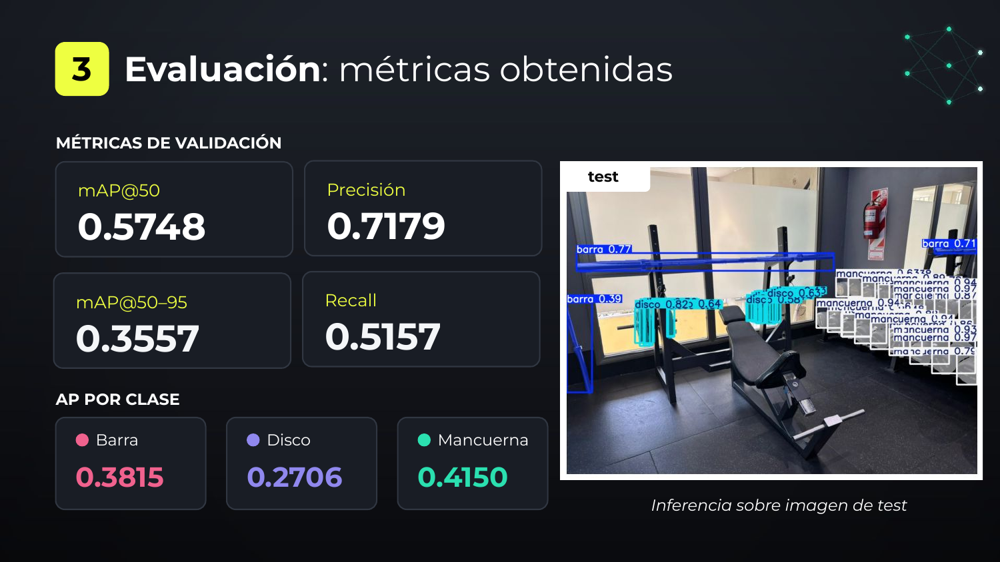

# Detección automática de equipamiento de gimnasio con YOLO26

Proyecto integrador grupal de **Redes Neuronales** — Universidad de Palermo.

Fine tuning de un modelo **YOLO26 Nano de segmentación** para detectar **barras, discos y mancuernas** en imágenes y videos de gimnasio. En la inferencia se combina con segmentación, estimación de pose y tracking.

## Notebooks

| Notebook | Qué hace |
|---|---|
| `notebooks/Gimnasio_Fine_Tuning_Vision.ipynb` | Carga del dataset, entrenamiento, curvas, matriz de confusión y evaluación |
| `notebooks/Gimnasio_Inferencia_Vision.ipynb` | Procesa videos propios con detección + tracking, segmentación, pose y contador de objetos |

Los dos están pensados para correr en **Google Colab con GPU (T4)**.

## Dataset

- 459 imágenes etiquetadas en Roboflow, con 3 clases: `barra`, `disco` y `mancuerna`.
- La mayoría son fotos propias tomadas en gimnasios, más algunas de internet.
- División: 70% entrenamiento, 15% validación y 15% test.
- Aumentación: rotación (±10º) y brillo (±12%). Imágenes de 768x768.

## Entrenamiento

- Modelo base: YOLO26 Nano (segmentación)
- 150 épocas, patience 30, imgsz 768
- Optimizador AdamW (elegido automáticamente)
- Tiempo aproximado: 80 minutos en una T4

## Resultados (validación)

| Métrica | Valor |
|---|---|
| Precisión | 0.72 |
| Recall | 0.52 |
| mAP@50 | 0.57 |
| mAP@50-95 | 0.36 |

mAP@50-95 por clase: barra 0.38, disco 0.27 y mancuerna 0.42.

El modelo acierta en la mayoría de sus detecciones (buena precisión), pero todavía se le escapan objetos (recall más bajo), sobre todo discos.

## Cómo usarlo

1. Abrir el notebook de fine tuning en Colab y activar la GPU.
2. Reemplazar `TU_ROBOFLOW_API_KEY` por tu propia API key de Roboflow. El dataset es privado, así que vas a necesitar uno propio con las mismas clases.
3. Ejecutar todas las celdas para entrenar y obtener `best.pt`.
4. En el notebook de inferencia, cargar ese `best.pt` y subir un video propio.

> Los pesos entrenados (`bestV27.pt`), el dataset y los videos no están incluidos en el repositorio.

## Equipo

- Aaron Fraga
- Juan Cruz Rey
- Juan Ignacio Pintarelli
- Santiago Minnaar Vizzotto
- Paula Goldenhorn
